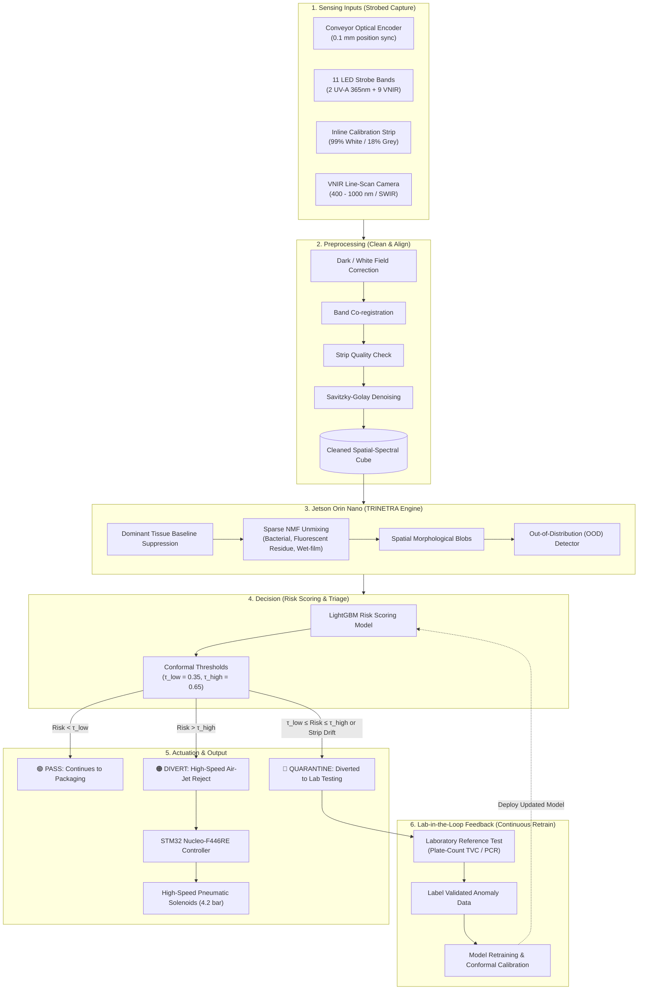

# 🏗️ OPTIX: System Architecture & Technical Pipeline

**System:** OPTIX (Adaptive Hyperspectral Inspection System)  
**Team:** Team AEROS (Team ID: 186870) | **SIH 2026 Problem Statement 26233**  
**Theme:** Agriculture, FoodTech & Rural Development | **Category:** Hardware  

---

## 1. End-to-End Functional Architecture

OPTIX solves the critical industry limitation of conventional food quality assurance—which relies on destructive, delayed (24–48 hr) laboratory culture sampling—by providing **100% inline non-destructive optical screening** at full conveyor line speeds (up to $2.5\text{ m/s}$).

---

## 2. Detailed Pipeline Stages

### Stage 1: Strobed Multimodal Acquisition
The conveyor optical encoder continuously tracks belt linear displacement. Every $0.25\text{ mm}$ of travel triggers a synchronized line capture. The 11-channel LED array executes a microsecond strobed firing sequence:
* **2x UV-A (365 nm):** Induces autofluorescence in microbial fluorophores (NADH, riboflavin, porphyrins, and bacterial fecal residues).
* **9x VNIR Bands:** Measures spectral reflectance across cellular tissue structure and moisture absorption bands ($950\text{ nm}$).
* **Calibration Strip Check:** Every line scan captures the lateral margin reference strip to track illuminator intensity drift and lens dust contamination.

### Stage 2: Hardware Preprocessing
Before neural processing, raw pixel digital counts are radiometric-corrected using inline flat-fielding:
$$R(\lambda) = \frac{I_{raw}(\lambda) - I_{dark}(\lambda)}{I_{white}(\lambda) - I_{dark}(\lambda)}$$
Band co-registration aligns all spectral channels, followed by Savitzky-Golay smoothing to eliminate optical detector shot noise.

### Stage 3: Jetson Orin Nano TRINETRA Engine
Healthy poultry meat or leafy green produce exhibits immense natural variance in color, moisture, and marbling that easily triggers false alarms in naive thresholding systems. TRINETRA uses:
1. **Food-Specific Baseline Modeling:** Matches sample against its category-specific spectral baseline.
2. **Dominant Tissue Suppression:** Subtracts the projected healthy food tissue subspace via Orthogonal Subspace Projection (OSP) or sparse Non-negative Matrix Factorization (NMF).
3. **Weak-Signal Extraction:** Recovers faint contamination residuals ($S_{residual}$) representing bacterial colonies or biofilm residue.
4. **Spatial Blob Feature Analysis:** Evaluates contiguous cluster sizes ($> 2\text{ mm}^2$) to distinguish genuine surface anomalies from specular reflections.

### Stage 4: Conformal Risk Scoring & Three-Way Triage
Instead of a brittle binary classification, OPTIX implements **Conformal Prediction** (Angelopoulos & Bates, 2021) anchored to official **FSSAI microbiological criteria (Tables 5A & 5B)**:
* **PASS ($\text{Risk} < \tau_{low} = 0.35$):** Normal spectral behavior within acceptable statistical bounds. Product proceeds undisturbed.
* **DIVERT ($\text{Risk} > \tau_{high} = 0.65$):** Unambiguous contamination anomaly detected. Air-jet diverter fires to isolate product.
* **QUARANTINE ($\tau_{low} \le \text{Risk} \le \tau_{high}$ OR calibration strip drift):** System detects an unexplained spectral variation or hardware sensor uncertainty. Product is safely routed to the quarantine holding bin for confirmatory lab culture/PCR.

### Stage 5: Synchronized Actuation
The STM32 Nucleo-F446RE receives target coordinates and classification from the Jetson via UART. Using its encoder pulse register, it fires the corresponding lateral pneumatic nozzle at the exact millisecond the target crosses the air-jet manifold ($18\text{ ms}$ pulse at $4.2\text{ bar}$).

### Stage 6: Lab-in-the-Loop Continuous Retraining
Quarantined samples undergo standard plate-count Total Viable Count (TVC) testing. The verified microbiological labels are matched back to the stored raw hyperspectral cubes to update the edge AI model, systematically eliminating edge-case blind spots over time.
